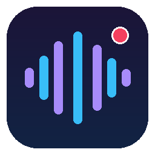
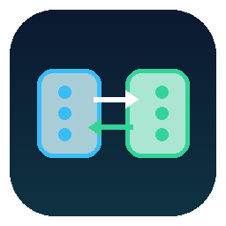

# Hi, ich bin Nico 👋

**Fachinformatiker für Anwendungsentwicklung · Full-Stack, Backend-APIs, KI-/Audio-Pipelines & Automatisierung**

---

### Über mich

Ich bin **Anwendungsentwickler** mit Leidenschaft für saubere Software-Architektur, durchdachte APIs und Systeme, die komplexe Abläufe zuverlässig automatisieren — von **verteilten Audio- und KI-Pipelines** über **moderne Full-Stack-Web- und Mobile-Apps** bis hin zu **automatisierten Backend-Schnittstellen**.

- 🎓 **Ausbildung & Praxis:** Abgeschlossene Ausbildung zum **Fachinformatiker für Anwendungsentwicklung (IHK)** bei der *Zeppelin Baumaschinen GmbH* (Java/Spring-Boot-Backend, atomare Datenbanktransaktionen, automatisierte PDF-Beleggenerierung sowie Entwicklung eines Python/`pytest`-REST-API-Testframeworks mit **70 % Zeitersparnis** in der Jenkins-CI/CD-Pipeline).
- 🧪 **Engineering-Fokus:** Reproduzierbare Benchmarks, typensichere Schnittstellen (`TypeScript`, `FastAPI`, `Pydantic`, `SQLAlchemy`), automatisierte Test-Suiten (`pytest`, `unittest`) und datensparsame Offline-/Cloud-Hybrid-Architekturen.
- 🔓 **Open Source & Live-Walkthroughs:** Meine wichtigsten Software-Projekte sind direkt als `Open Source` verlinkt. Weitere selbstgehostete Systeme aus meinem Homelab sind als `Private` aufgeführt — **Code-Walkthroughs und Live-Demos zeige ich jederzeit gerne im Gespräch!**

---

## ⭐ Ausgewählte Software- & Flaggschiff-Projekte (Open Source)

<table>
  <tr>
    <td width="50%" valign="top">
      
      <a href="https://github.com/n-bross/keepsaid"><b>Keepsaid</b></a> 
      
       
      <b>Persönliches Audioarchiv &amp; Review-Server:</b> Verteilte Sprach-Pipeline mit Rauschunterdrückung (RNNoise / MossFormer2), GPU-Transkription via <code>mlx-whisper</code> auf Apple Silicon, Sprecher-Erkennung, HTTP-Range-Streaming und interaktiver Web-Review-UI zum wortweisen Mitlesen. 
      <code>Python</code> · <code>MLX-Whisper</code> · <code>SQLite</code> · <code>FFmpeg</code> · <code>unittest</code>
    </td>
    <td width="50%" valign="top">
      
      <a href="https://github.com/n-bross/speech-lab"><b>Speech Lab</b></a> 
      
       
      <b>Reproduzierbare ASR- &amp; Diarization-Benchmark-Suite:</b> Evaluierungsplattform zum systematischen Vergleich lokaler (MLX, Sherpa-ONNX, ECAPA-TDNN) und 11+ Cloud-Sprachmodelle (WER, CER, DER, Wortzeit-Alignment) gegen <code>SHA256</code>-verankerte Referenzen mit PostgreSQL-JSONB-Backend. 
      <code>Python</code> · <code>PostgreSQL</code> · <code>ASR Benchmarking</code> · <code>Diarization</code> · <code>Web UI</code>
    </td>
  </tr>
  <tr>
    <td width="50%" valign="top">
      
      <a href="https://github.com/n-bross/chaxterlog"><b>ChaxterLog</b></a> 
      
       
      <b>Event-basiertes Besucher- &amp; Aktivitäts-Tracking:</b> Für den schnellen Thekenbetrieb am Tablet und Smartphone optimierte Full-Stack-Web-App mit inkrementeller Offline-Queue-Synchronisation, Rollen-/Teamverwaltung, SHA-256 Setup-Flow und statistischer Auswertung. 
      <code>Next.js 15</code> · <code>TypeScript</code> · <code>Tailwind CSS 4</code> · <code>Neon PostgreSQL</code> · <code>Better Auth</code>
    </td>
    <td width="50%" valign="top">
      
      <a href="https://github.com/n-bross/JUFO-Web"><b>JUFO-Web</b></a> 
      
       
      <b>Web-Plattform für das Jugendforum Grafing:</b> Full-Stack-Vereinsportal mit Online-Eventanmeldung, Bewerbungs- &amp; Kontakt-Workflows, Turnierplaner und Serverless-PostgreSQL-Backend. 
      <code>React 18</code> · <code>TypeScript</code> · <code>Vite</code> · <code>Tailwind CSS 4</code> · <code>PostgreSQL</code>
    </td>
  </tr>
  <tr>
    <td width="50%" valign="top">
      
      <a href="https://github.com/n-bross/PriceWatch"><b>PriceWatch</b></a> 
      
       
      <b>Native iOS-App für smarte Einkaufslisten &amp; Preisvergleiche:</b> Kombiniert aktuelle Prospekt-Angebote deutscher Einzelhändler mit einer intelligenten Einkaufsliste, automatischer Einheiten-Normalisierung und Cloud-Synchronisation. 
      <code>Swift</code> · <code>SwiftUI</code> · <code>Supabase</code> · <code>PostgreSQL</code> · <code>iOS</code>
    </td>
    <td width="50%" valign="top">
      
      <a href="https://github.com/n-bross/Caldav-Setup"><b>Todo-Kalender (CalDAV Sync API)</b></a> 
      
       
      <b>Task- &amp; Kalender-Backend mit bidirektionalem CalDAV-Sync:</b> Asynchrones FastAPI- und SQLAlchemy-Backend zur Aufgaben-, Fokusblock- und Timer-Steuerung mit Radicale-CalDAV-Worker und Home-Assistant-Anbindung. 
      <code>Python</code> · <code>FastAPI</code> · <code>Async SQLAlchemy</code> · <code>CalDAV</code> · <code>pytest</code>
    </td>
  </tr>
  <tr>
    <td width="50%" valign="top">
      
      <a href="https://github.com/n-bross/live-meeting-copilot-mvp"><b>Live Meeting Copilot</b></a> 
      
       
      <b>Echtzeit-Meeting-Assistent &amp; Action-Item-Detektor:</b> Lokales Streaming-ASR mit <code>faster-whisper</code>, Sprecherwechsel-Erkennung, akustischer Namens-Erwähnungs-Warnung, automatischer Aufgaben-Extraktion und FastAPI-Live-Dashboard. 
      <code>Python</code> · <code>Faster-Whisper</code> · <code>FastAPI</code> · <code>Real-Time Audio</code>
    </td>
    <td width="50%" valign="top">
      
      <a href="https://github.com/n-bross/intunes-macmon-Skript"><b>Intune → MacMon Sync Pipeline</b></a> 
      
       
      <b>Enterprise REST-API-Synchronisations-Pipeline:</b> Synchronisiert verwaltete Endgeräte aus Microsoft Intune (Graph API inkl. Paging &amp; Detail-Enrichment) parallelisiert in ein MacMon-NAC-System inkl. 7-stufiger Preflight-Diagnose. 
      <code>PowerShell 7</code> · <code>Microsoft Graph API</code> · <code>REST API</code> · <code>Parallel Processing</code>
    </td>
  </tr>
  <tr>
    <td width="50%" valign="top">
      
      <a href="https://github.com/n-bross/ha-hermes-conversation"><b>Hermes Home Assistant Integration</b></a> 
      
       
      <b>KI-Sprachassistent für Home Assistant Assist:</b> HACS Custom Integration, die Sprachbefehle über eine asynchrone FastAPI-Bridge mit persistentem SQLite-Gedächtnis an einen selbstgehosteten KI-Agenten anbindet. 
      <code>Python</code> · <code>Home Assistant</code> · <code>FastAPI</code> · <code>SQLite</code> · <code>HACS</code>
    </td>
    <td width="50%" valign="top">
      
      <a href="https://github.com/n-bross/vacuum_room_scheduler"><b>Vacuum Room Scheduler</b></a> 
      
       
      <b>Smart-Home-Raumreinigungs-Automatisierung:</b> Home Assistant Custom Integration für etagenbasierte Raumerkennung, separate Saug-/Wisch-Intervalle, Anwesenheitsprüfung und interaktive Sprach-Rückfragen (TTS). 
      <code>Python</code> · <code>Home Assistant</code> · <code>HACS</code> · <code>AsyncIO</code> · <code>TTS</code>
    </td>
  </tr>
</table>

<b>📂 Weitere Open-Source-Tools &amp; Private Self-Hosted-Projekte anzeigen (15 Projekte)</b>

 

| Logo | Projekt | Status | Kurzbeschreibung & Tech-Stack |
| :---: | :--- | :---: | :--- |
|  | [**Iris**](https://github.com/n-bross/iris) | [`Open Source`](https://github.com/n-bross/iris) | Plattformübergreifendes Sync-CLI & Daemon (`launchd`/`systemd`) für KI-Agent-Skills zwischen Claude Code, Codex, Gemini & Antigravity (`Python`, `CLI`, `unittest`) |
|  | [**Haus-Aufgaben-Tracker**](https://github.com/n-bross/Haus-Aufgaben-Tracker) | [`Open Source`](https://github.com/n-bross/Haus-Aufgaben-Tracker) | Aufgaben- und Haushalts-Tracker (`GitHub Repository`) |
|  | **Token-Maxing** | `Private` | Multi-Account AI Gateway & Telemetrie-Plattform mit SSE-Streaming, Failover & Next.js-Dashboard (`TypeScript`, `Fastify`, `Next.js`, `SQLite`) |
|  | **CLIProxyAPI** | `Private` | Unified AI-Proxy-Server in Go mit Management-Konsole für OpenAI-/Claude-/Gemini-kompatible REST-Endpunkte (`Go`, `REST API`, `OAuth`) |
|  | **Odysseus** | `Private` | Selbstgehosteter KI-Wissens- & Recherche-Stack mit Vektordatenbank, Metasuche & Push-Alerts (`Python`, `ChromaDB`, `SearXNG`, `ntfy`) |
|  | **where2watch** | `Private` | Werbefreie Cross-Platform-Streaming-Suchmaschine mit eigenem Python-TMDB-Adapter (`Flutter`, `Dart`, `Python`, `TMDB API`) |
|  | **Orbit // Mission Control** | `Private` | Echtzeit-Service- & Telemetrie-Dashboard mit Live-Latenzmessung und Dual-Design-Engine (`Node.js`, `JavaScript`, `HTML5 / CSS3`) |
|  | **Fleet** | `Private` | Multi-Host-Orchestrierungs-CLI (`fleet doctor`, `fleet sync`) über Linux, TrueNAS & macOS inkl. 1Password-Injektion (`Python`, `Bash`, `systemd`) |
|  | **Argus** | `Private` | Selbstgehosteter Observability- & Metrik-Stack mit eigenem Python-Prozess-Exporter (`Python`, `Prometheus`, `Grafana`, `Docker`) |
|  | **TrueNAS-Setup** | `Private` | Eigenes Python-Ansible-Modul (`truenas_app.py`) & Playbooks zur deklarativen Verwaltung von 40+ Diensten (`Python`, `Ansible`, `TrueNAS SCALE`) |
|  | **Bewerbungsstudio** | `Private` | Datengetriebene LaTeX-Bewerbungsplattform (`moderncv`) mit Kanban-Web-UI und automatischer PDF-Kompilierung (`Python`, `LaTeX`, `Web UI`) |
|  | **Arbeitsamt-PDF-Creator** | `Private` | Automatisierte Erstellung, Zusammenführung und Archivierung standardisierter PDF-Nachweise (`Python`, `PDF Automation`) |
|  | **Go60-ZMK** | `Private` | Custom Split-Keyboard-Firmware, ergonomische Layer-Architektur & lokale Zephyr-Build-Pipeline für das MoErgo Go60 (`C`, `ZMK`, `Zephyr RTOS`) |
|  | **Book Orbit** | `Private` | Selbstgehosteter Hörbuch- & E-Book-Medienserver auf TrueNAS SCALE mit Fortschrittssynchronisation (`Docker`, `TrueNAS SCALE`) |
|  | **Ai-Note-Dock** | `Private` | Embedded Hardware-Konzept für einen Raspberry Pi Zero 2 W Bluetooth-Audiorekorder mit Smart-Dock-Upload (`Embedded Linux`, `BlueZ`, `PipeWire`) |

---

## 🧰 Tech-Stack & Schwerpunkte

| Bereich | Technologien & Werkzeuge |
| :--- | :--- |
| **Sprachen** |         |
| **Backend, Web & APIs** |        |
| **Mobile, Audio & KI** |       |
| **Testing, CI/CD & Infra** |       |
