

# Hi, ich bin Nico 👋

**Fachinformatiker für Anwendungsentwicklung · Backend, KI-/Audio-Pipelines, Full-Stack & Self-Hosted Infrastructure**

---

### Über mich

Ich entwickle Software und Infrastruktur, die reale Alltags- und Geschäftsprobleme zuverlässig automatisiert — von **verteilten Audio- und KI-Pipelines** über **moderne Web- und Mobile-Apps** bis hin zu einer **deklarativ verwalteten Multi-Host-Serverlandschaft**.

- 🎓 **Ausbildung & Praxis:** Abgeschlossene Ausbildung zum **Fachinformatiker für Anwendungsentwicklung (IHK)** bei der *Zeppelin Baumaschinen GmbH* (Java/Spring-Boot-Backend, atomare Datenbanktransaktionen, automatisierte PDF-Beleggenerierung sowie Entwicklung eines Python/`pytest`-REST-API-Testframeworks mit **70 % Zeitersparnis** in der Jenkins-CI/CD-Pipeline).
- 🏗️ **System-Architektur im eigenen Lab:** Ich betreibe ein produktives Multi-Node-Setup (Linux-VPS, TrueNAS SCALE mit ZFS, dedizierte KI-Jails, Home Assistant OS & Apple-Silicon-Worker), vernetzt über ein Zero-Trust-Mesh (Tailscale) mit zentralem Monitoring, SSO und Secret-Management.
- 🔒 **Hinweis zu Repository-Sichtbarkeiten:** Da viele meiner produktiven Systeme direkt in meine eigene Infrastruktur oder kommunale Umgebungen eingebunden sind, sind die zugehörigen Repositories als `Private / Self-Hosted` gekennzeichnet. Öffentliche Projekte sind direkt verlinkt (`Open Source`) — **Architektur-Einblicke, Live-Demos und Code-Walkthroughs zeige ich jederzeit gerne im Gespräch!**

---

## 🚀 Projekt-Portfolio

### 🎙️ KI, Audio-Engineering & Developer Tools

<table>
  <tr>
    <td width="84" align="center" valign="middle">
      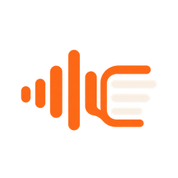
    </td>
    <td valign="top">
      <b>Keepsaid &amp; Soundcore-Export</b> &nbsp;
       
      <b>Persönliches Audioarchiv &amp; verteilte Sprach-Pipeline:</b> Automatischer Cloud-Ingest mit lokaler <code>AES-256-GCM</code>-Entschlüsselung, mehrstufiger Rauschunterdrückung (RNNoise / FlowSE), GPU-beschleunigter Transkription via <code>mlx-whisper</code> auf Apple Silicon, Sprecher-Diarisierung (PyAnnote), kontextgestützter Stimmzuordnung und interaktivem Web-Review-UI zum wortweisen Mitlesen. 
      <code>Python</code> · <code>FastAPI</code> · <code>MLX-Whisper</code> · <code>PyAnnote</code> · <code>FFmpeg</code> · <code>Docker</code> · <code>Tailscale</code>
    </td>
  </tr>
  <tr>
    <td width="84" align="center" valign="middle">
      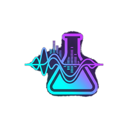
    </td>
    <td valign="top">
      <b>Speech Lab</b> &nbsp;
       
      <b>Reproduzierbare Benchmark-Suite für deutsche Spracherkennung (ASR):</b> Lokales Evaluierungslabor zum systematischen Vergleich von lokalen und Cloud-Sprachmodellen, exakter Wortzeitmarken-Ausrichtung (Word-Boundary Timing) und Mehrsprecher-Erkennung gegen <code>SHA256</code>-verankerte Referenztranskripte. 
      <code>Python</code> · <code>ASR Benchmarking</code> · <code>Speaker Diarization</code> · <code>Web UI</code> · <code>pytest</code>
    </td>
  </tr>
  <tr>
    <td width="84" align="center" valign="middle">
      
    </td>
    <td valign="top">
      <b>Fleet</b> &nbsp;
       
      <b>Multi-Host-Orchestrierung &amp; Service-Health-Radar:</b> Zentrales CLI-Werkzeug (<code>fleet doctor</code>, <code>fleet sync</code>, <code>fleet portfolio</code>) zur Überwachung und Synchronisation von über 45 Repositories und Diensten über Linux-VPS, TrueNAS, Home Assistant und macOS hinweg — inklusive Zero-Secret-Architektur durch dynamische 1Password-Injektion (<code>op://</code>) zur Laufzeit. 
      <code>Python</code> · <code>Bash</code> · <code>1Password CLI</code> · <code>systemd</code> · <code>Tailscale</code> · <code>Git Worktrees</code>
    </td>
  </tr>
  <tr>
    <td width="84" align="center" valign="middle">
      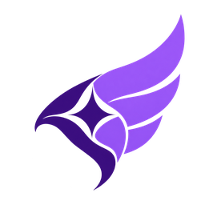
    </td>
    <td valign="top">
      <b>Iris</b> &nbsp;
       
      <b>„Die Botin für deine Agent-Skills“:</b> Plattformübergreifender Synchronisations-Daemon (macOS <code>launchd</code> &amp; Linux), der eigene KI-Workflows, Regeln und Skills deklarativ und konfliktfrei zwischen Claude Code, Codex, T3 Code, Cursor, Gemini CLI und Antigravity verteilt. 
      <code>Python</code> · <code>Shell</code> · <code>launchd</code> · <code>Developer Experience</code>
    </td>
  </tr>
  <tr>
    <td width="84" align="center" valign="middle">
      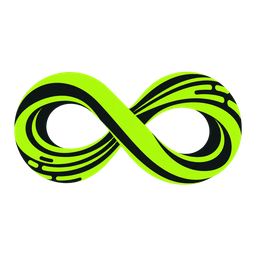
    </td>
    <td valign="top">
      <b>Token-Maxing</b> &nbsp;
       
      <b>Multi-Account AI Gateway &amp; Telemetrie-Plattform:</b> Lokaler API-Router für OpenAI- und Anthropic-Workloads mit SSE-Streaming-Parser, automatischem OAuth-Token-Refresh, Rate-Limit-Failover, SQLite-Telemetrie und Next.js-Dashboard zur Echtzeit-Quota-Analyse. 
      <code>TypeScript</code> · <code>Fastify</code> · <code>Next.js</code> · <code>SQLite</code> · <code>SSE Streaming</code>
    </td>
  </tr>
  <tr>
    <td width="84" align="center" valign="middle">
      
    </td>
    <td valign="top">
      <b>CLIProxyAPI</b> &nbsp;
       
      <b>Unified AI-Proxy-Server mit Web-Management-Konsole:</b> Hochperformanter Go-Service, der CLI-basierte KI-Zugänge unter standardisierten OpenAI-, Claude- und Gemini-kompatiblen REST-Endpunkten mit Multi-Account-Load-Balancing bereitstellt. 
      <code>Go</code> · <code>REST API</code> · <code>OAuth</code> · <code>Docker</code>
    </td>
  </tr>
  <tr>
    <td width="84" align="center" valign="middle">
      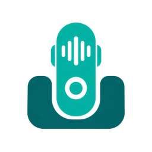
    </td>
    <td valign="top">
      <b>Ai-Note-Dock</b> &nbsp;
       
      <b>Embedded Bluetooth-Audiorekorder &amp; Smart-Dock:</b> Systemarchitektur für einen auf dem Raspberry Pi Zero 2 W basierenden Dual-Mode-Bluetooth-Rekorder (A2DP/HFP via BlueZ &amp; PipeWire) mit automatischem Upload und Lade-Management beim Eindocken. 
      <code>Embedded Linux</code> · <code>Raspberry Pi</code> · <code>BlueZ</code> · <code>PipeWire</code>
    </td>
  </tr>
</table>

---

### 🌐 Full-Stack Web, Mobile & Workflow-Anwendungen

<table>
  <tr>
    <td width="84" align="center" valign="middle">
      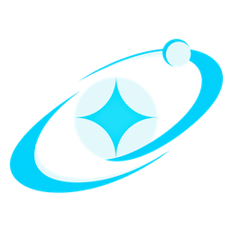
    </td>
    <td valign="top">
      <b>Orbit // Mission Control</b> &nbsp;
       
      <b>Echtzeit-Service- &amp; Telemetrie-Dashboard:</b> Zentrale Start- und Monitoring-Plattform für alle Dienste im Homelab und Tailnet mit serverseitigen Live-Health-Pings, Latenzmessung, Host-Filterung und umschaltbarer Dual-Design-Engine (<i>Stark HUD</i> &amp; <i>Cupertino Glass</i>). 
      <code>Node.js</code> · <code>JavaScript</code> · <code>HTML5 / CSS3</code> · <code>REST API</code> · <code>systemd</code>
    </td>
  </tr>
  <tr>
    <td width="84" align="center" valign="middle">
      
    </td>
    <td valign="top">
      <b>ChaxterLog</b> &nbsp;
       
      <b>Besucher-Analytics &amp; Verwaltungsplattform für das Schülercafé Grafing („Chaxter“):</b> Für den schnellen Thekenbetrieb am Tablet und Smartphone optimierte Web-App zur tagesaktuellen Besucherzählung, Rollen- und Teamverwaltung sowie statistischen Auswertung. 
      <code>Next.js (App Router)</code> · <code>TypeScript</code> · <code>Tailwind CSS</code> · <code>Neon PostgreSQL</code> · <code>Better Auth</code>
    </td>
  </tr>
  <tr>
    <td width="84" align="center" valign="middle">
      
    </td>
    <td valign="top">
      <a href="https://github.com/n-bross/JUFO-Web"><b>JUFO-Web</b></a> &nbsp;
       
      <b>Web-Plattform für das Jugendforum Grafing:</b> Full-Stack-Webanwendung mit durchgängiger Typsicherheit vom Datenbankschema bis zum Frontend im modernen T3-Stack. 
      <code>Next.js</code> · <code>TypeScript</code> · <code>tRPC</code> · <code>Prisma ORM</code> · <code>Tailwind CSS</code>
    </td>
  </tr>
  <tr>
    <td width="84" align="center" valign="middle">
      <a href="https://github.com/n-bross/PriceWatch">
        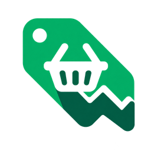
      </a>
    </td>
    <td valign="top">
      <a href="https://github.com/n-bross/PriceWatch"><b>PriceWatch</b></a> &nbsp;
       
      <b>Native iOS-App für smarte Einkaufslisten &amp; Supermarkt-Preisvergleiche:</b> Kombiniert aktuelle Prospekt-Angebote deutscher Einzelhändler mit einer intelligenten Einkaufsliste und Cloud-Synchronisation. 
      <code>Swift</code> · <code>SwiftUI</code> · <code>Supabase</code> · <code>iOS</code>
    </td>
  </tr>
  <tr>
    <td width="84" align="center" valign="middle">
      
    </td>
    <td valign="top">
      <a href="https://github.com/n-bross/where2watch"><b>where2watch</b></a> &nbsp;
       
      <b>Open-Source-Streaming-Suchmaschine:</b> Werbefreie Cross-Platform-Alternative zu JustWatch — zeigt sofort, bei welchem Anbieter Filme und Serien im Abo, zur Leihe oder zum Kauf verfügbar sind, gestützt durch einen eigenen Python-TMDB-Adapter. 
      <code>Flutter</code> · <code>Dart</code> · <code>Python</code> · <code>TMDB API</code>
    </td>
  </tr>
  <tr>
    <td width="84" align="center" valign="middle">
      
    </td>
    <td valign="top">
      <b>Bewerbungsstudio (bewerbung-latex)</b> &nbsp;
       
      <b>Datengetriebene LaTeX-Bewerbungsplattform mit Web-UI:</b> Trennt strukturierte CSV-/Metadaten strikt vom Textsatz (<code>moderncv</code>), bietet ein lokales Kanban-Board zur Prozessverfolgung und kompiliert Anschreiben, Lebenslauf und Zeugnismappen vollautomatisch zu druckfertigen PDFs. 
      <code>Python</code> · <code>LaTeX</code> · <code>Web UI</code> · <code>Document Automation</code>
    </td>
  </tr>
  <tr>
    <td width="84" align="center" valign="middle">
      
    </td>
    <td valign="top">
      <b>Arbeitsamt-PDF-Creator</b> &nbsp;
       
      <b>Automatisierte Nachweis- &amp; Beleggenerierung:</b> Spezialisiertes Python-Tooling zur datengesteuerten Erstellung, Zusammenführung und Archivierung standardisierter PDF-Nachweise. 
      <code>Python</code> · <code>PDF Processing</code> · <code>CLI Automation</code>
    </td>
  </tr>
</table>

---

### 🏠 Smart Home, Homelab & System-Infrastruktur

<table>
  <tr>
    <td width="84" align="center" valign="middle">
      <a href="https://github.com/n-bross/ha-hermes-conversation">
        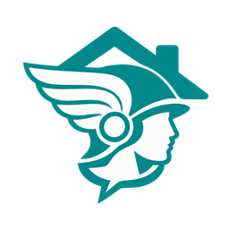
      </a>
    </td>
    <td valign="top">
      <a href="https://github.com/n-bross/ha-hermes-conversation"><b>Hermes Home Assistant Conversation</b></a> &nbsp;
       
      <b>KI-Sprachassistenten-Integration für Home Assistant Assist:</b> HACS-kompatible Custom Integration, die Sprachbefehle und Satz-Trigger über eine asynchrone FastAPI-Bridge mit persistentem SQLite-Konversationsgedächtnis an einen selbstgehosteten KI-Agenten anbindet. 
      <code>Python</code> · <code>Home Assistant</code> · <code>FastAPI</code> · <code>SQLite</code> · <code>HACS</code>
    </td>
  </tr>
  <tr>
    <td width="84" align="center" valign="middle">
      <a href="https://github.com/n-bross/vacuum_room_scheduler">
        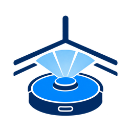
      </a>
    </td>
    <td valign="top">
      <a href="https://github.com/n-bross/vacuum_room_scheduler"><b>Vacuum Room Scheduler</b></a> &nbsp;
       
      <b>Intelligente Raumreinigungs-Steuerung für Home Assistant:</b> Custom Integration für raumbasierte Reinigungsintervalle, Anwesenheitserkennung, Fehler-Recovery und kontextabhängige Sprachbenachrichtigungen. 
      <code>Python</code> · <code>Home Assistant</code> · <code>IoT Automation</code>
    </td>
  </tr>
  <tr>
    <td width="84" align="center" valign="middle">
      
    </td>
    <td valign="top">
      <b>Odysseus</b> &nbsp;
       
      <b>Selbstgehosteter KI-Wissens- &amp; Recherche-Stack:</b> Containerisierte Umgebung mit semantischer Vektordatenbank (ChromaDB), datenschutzfreundlicher Metasuchmaschine (SearXNG) und Echtzeit-Push-Benachrichtigungen (ntfy). 
      <code>Python</code> · <code>Docker Compose</code> · <code>ChromaDB</code> · <code>SearXNG</code> · <code>ntfy</code>
    </td>
  </tr>
  <tr>
    <td width="84" align="center" valign="middle">
      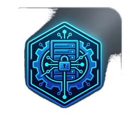
    </td>
    <td valign="top">
      <b>TrueNAS-Setup &amp; Ansible Homelab</b> &nbsp;
       
      <b>Deklarative Server- &amp; Storage-Infrastruktur:</b> Verwaltet über 40 Docker-Container, ZFS-Storage-Pools, einen föderierten Matrix-Homeserver (Synapse, Matrix Authentication Service, LiveKit-RTC &amp; Bridges), Authentik-SSO und Reverse-Proxies (Caddy) per Ansible und GitOps-Workflows. 
      <code>Ansible</code> · <code>TrueNAS SCALE</code> · <code>ZFS</code> · <code>Docker</code> · <code>Caddy</code> · <code>Authentik</code> · <code>Matrix</code>
    </td>
  </tr>
  <tr>
    <td width="84" align="center" valign="middle">
      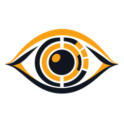
    </td>
    <td valign="top">
      <b>Argus</b> &nbsp;
       
      <b>Selbstgehosteter Monitoring- &amp; Metrik-Stack:</b> Erfasst und visualisiert System-, Container- und Netzwerkmetriken über alle Hosts im Tailnet hinweg mit Langzeit-Zeitreihenspeicherung und Alerting. 
      <code>Prometheus</code> · <code>Grafana</code> · <code>VictoriaMetrics</code> · <code>Node Exporter</code> · <code>cAdvisor</code>
    </td>
  </tr>
  <tr>
    <td width="84" align="center" valign="middle">
      
    </td>
    <td valign="top">
      <b>Book Orbit</b> &nbsp;
       
      <b>Selbstgehosteter Hörbuch- &amp; E-Book-Medienserver:</b> Zentraler Medien-Stack auf TrueNAS SCALE mit automatisierter Metadaten-Aufbereitung, Fortschrittssynchronisation und mobilem Streaming. 
      <code>Docker</code> · <code>TrueNAS SCALE</code> · <code>Self-Hosted</code>
    </td>
  </tr>
  <tr>
    <td width="84" align="center" valign="middle">
      
    </td>
    <td valign="top">
      <b>ADHD Task Orchestrator</b> &nbsp;
       
      <b>Fokus-Timer &amp; Aufgaben-Orchestrierung:</b> Verbindet Aufgabenplanung, Raycast-Schnellzugriffe auf macOS und physische Smart-Home-Signale (Licht-/TTS-Feedback über Home Assistant) für fokussierte Deep-Work-Sessions. 
      <code>Python</code> · <code>Raycast</code> · <code>Home Assistant API</code> · <code>REST</code>
    </td>
  </tr>
  <tr>
    <td width="84" align="center" valign="middle">
      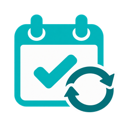
    </td>
    <td valign="top">
      <b>Todo-Kalender (CalDAV Sync)</b> &nbsp;
       
      <b>Bidirektionale Aufgaben- &amp; Kalender-Synchronisation:</b> Eigener Radicale-CalDAV-Stack mit Python-Synchronisationsdienst, der offene Aufgaben automatisch als terminierte Kalenderblöcke auf iOS und macOS abbildet. 
      <code>Python</code> · <code>CalDAV</code> · <code>Radicale</code> · <code>Docker</code>
    </td>
  </tr>
  <tr>
    <td width="84" align="center" valign="middle">
      
    </td>
    <td valign="top">
      <a href="https://github.com/n-bross/Go60-ZMK"><b>Go60-ZMK</b></a> &nbsp;
       
      <b>Custom Split-Keyboard-Firmware &amp; lokale Build-Pipeline:</b> Maßgeschneiderte ZMK-Konfiguration, ergonomische Layer-Architektur (HRM, Symbol- &amp; Navigation-Layer) und reproduzierbare Zephyr-RTOS-Builds für das MoErgo Go60. 
      <code>C / Devicetree</code> · <code>ZMK Firmware</code> · <code>Zephyr RTOS</code> · <code>GitHub Actions</code>
    </td>
  </tr>
</table>

---

## 🧰 Tech-Stack & Schwerpunkte

| Bereich | Technologien & Werkzeuge |
| :--- | :--- |
| **Sprachen** |         |
| **Backend & Web** |        |
| **Mobile, Audio & KI** |       |
| **DevOps, Infra & QA** |         |
